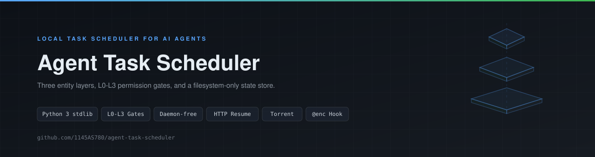
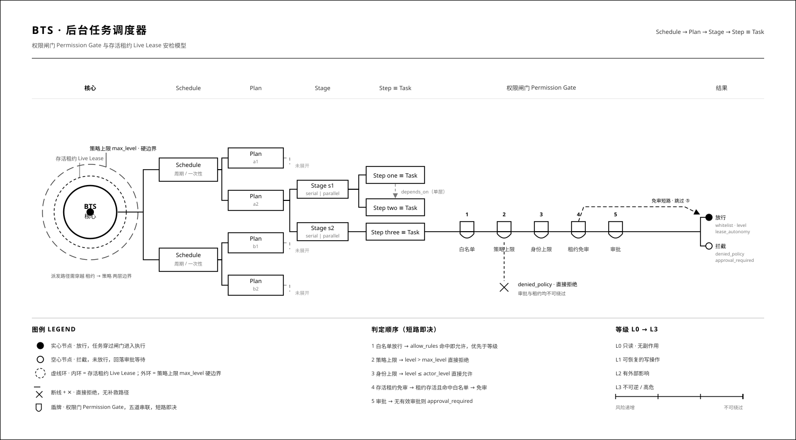

# Background Task Scheduler

<p align="center">
  
</p>

**English** | [中文](README.zh-CN.md)

A purely local, daemon-free task scheduler for AI agents. Commands are split into three entity layers, the filesystem is the single source of truth, and the agent advances state between turns.

- No external services, no third-party libraries — Python 3 standard library only
- All state lives in `BTS_ROOT` (default `<cwd>/.bts`): plain text, editable by hand, versionable, backup-friendly
- Every command prints JSON so an agent can parse it; exit codes are stable
- Zero background processes. Nothing runs unless the agent (or a human) asks it to

## When to use it

**Fits**

- Long commands that should not hold the conversation turn: training runs, builds, batch transcoding, long test suites
- Repeating the same command set on a cadence: patrols, polling, scheduled scraping
- Ordered command chains where a failed step should skip its downstream
- Flaky work that needs automatic retry with backoff
- High-risk commands (deletes, releases, touching production data) that need a human to approve first
- Post-hoc review of what ran, in what order, with what exit code
- Batch downloads with resume and rate limiting; torrents and magnets via aria2c

**Does not fit**

- Millisecond-scale atomic operations that must complete inside one transaction
- True distributed locking or multi-machine coordination — this is single-machine file-lock semantics only
- Second-accurate scheduling — the agent drives it by polling, so precision equals the polling interval
- Tamper-proof authentication — identity comes from config or environment variables and is declarative, not a security boundary

## Three layers

| Layer | Lives in | Responsibility | Lifetime |
| --- | --- | --- | --- |
| Task | `tasks/<task_id>/` | One command plus permission and timeout | One execution |
| Plan | `schedules/<sid>/plans/<pid>/` | One orchestration: multiple stages, each with multiple steps | One orchestration |
| Schedule | `schedules/<sid>/schedule.json` | Triggers a plan periodically or once | Long-lived |

Steps inside a stage may declare a single-level `depends_on`. Cross-stage ordering is expressed by stage boundaries: the next stage starts only after the previous one fully ends.

```
Schedule (periodic or one-shot)
  └─ Plan (attempt N, id = <sid>-a<N>)
       ├─ Stage s1 (serial | parallel)
       │    ├─ Step one  ──→ may depends_on peers in the same stage
       │    ├─ Step two
       │    └─ Step three
       └─ Stage s2
```

Every step is a task behind a permission gate, so it reuses the task layer's approval, events, and logging.

<p align="center">
  <picture>
    <source media="(prefers-color-scheme: dark)" srcset="assets/bts-architecture-dark.svg">
    
  </picture>
</p>

## Requirements

- Python 3 (standard library only)
- `aria2c` on `PATH` — only if you want torrent and magnet downloads

## Quick start

```bash
# Create a task (permission level defaults to L0)
python scripts/bts.py create build --command "gradle build" --level L1

# Run it and wait
python scripts/bts.py run build --wait

# Inspect
python scripts/bts.py status build --json
python scripts/bts.py show build --lines 50
```

Plans, schedules, and downloads:

```bash
python scripts/bts_plan.py create --spec references/examples/plan-deps-retry.json
python scripts/bts_plan.py run <plan-id> --wait
python scripts/bts.py download --url https://example.com/file.bin --out ./dl --wait
python scripts/bts.py torrent --magnet "magnet:?xt=urn:btih:..." --out ./dl --wait
```

## Permission tiers

| Level | Meaning | Approval |
| --- | --- | --- |
| L0 | Read-only and harmless | Never |
| L1 | Local writes, builds | Policy-dependent |
| L2 | Network, package installs | Usually required |
| L3 | Deletes, releases, production data | Always required |

Approvals have an expiry, support batch approval, and honour a whitelist. A high-risk command without a valid approval exits with code 4.

Exit codes: `0` success, `2` bad arguments or missing confirmation, `3` missing object or state conflict, `4` insufficient permission.

## Repository layout

```
SKILL.md                    Entry point: triggers and the full work loop
references/                 Specs loaded on demand
├── orchestration-spec.md   Stages, steps, dependencies, failure propagation
├── permissions.md          L0-L3 tiers, approval flow, whitelist
├── data-model.md           Every field of task/plan/schedule records
├── storage-layout.md       Directory tree under BTS_ROOT
├── state-machine.md        State transitions and terminal states
├── error-taxonomy.md       Error classes and the retry matrix
├── command-guide.md        How to write and invoke commands
├── anti-patterns.md        Common misuse and why it breaks
└── examples/               Runnable minimal samples
scripts/                    The scheduler itself
├── bts.py                  Task layer: create, run, download, torrent, approvals
├── bts_plan.py             Plan and schedule layer
├── bts_download.py         HTTP downloader with resume and integrity check
└── bts_torrent.py          aria2c wrapper for torrents and magnets
```

## Conventions

- `SKILL.md` is the only entry point; the YAML `description` decides when the skill triggers, the body routes to deeper documents
- `references/` is plural and flat — topic files sit directly beneath it, no further nesting
- `scripts/` holds executables only, no prose; scripts resolve their own paths and never hardcode absolute ones
- Samples live under `references/examples/` because they are documentation, not tooling
- No build artifacts: `__pycache__/`, `.bts/`, logs, and caches stay out

## Notes

- The scheduler writes nothing outside `BTS_ROOT`. Deleting that directory resets all state.
- State is plain files by design: you can inspect, edit, diff, and back it up without special tooling.
- Paths in the documents use placeholders such as `<cwd>`; they do not correspond to any specific project.

## License

Released under the [MIT License](LICENSE). Free to use, modify, and redistribute, provided the copyright notice is retained.
