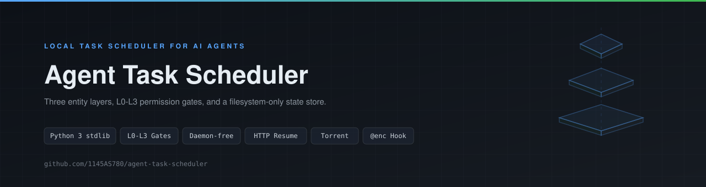

# Agent 任务调度器

*你的 Agent 能中途转向的调度器*

<p align="center">
  
</p>

[English](README.md) | **中文**

面向 AI Agent 的纯本地、无守护进程任务调度器。它把「命令」分成三层实体，用文件系统作为唯一状态源，由 Agent 在轮次之间主动推进。

- 不依赖外部服务、不依赖第三方库，仅用 Python 3 标准库
- 所有状态落在 `ATS_ROOT`（默认 `<cwd>/.ats`）：纯文本，可手改、可版本控制、可异地备份
- 每个命令都以 JSON 输出，便于 Agent 解析；退出码语义稳定
- 零后台进程。没人让它跑，它就不跑

## 为什么不是 cron 任务

| | cron / systemd timer | Agent 任务调度器 |
| --- | --- | --- |
| 谁启动 | 人去改 crontab | Agent，在对话轮次里发起 |
| 谁能中途干预 | 没人；只能等它结束或杀掉 | Agent 每轮查询状态并重新决策 |
| 输出形态 | 日志文本 | JSON，退出码语义稳定 |
| 高风险命令 | 没有闸门 | L0-L3 分级 + 带有效期的审批 |

## 什么时候用

**适用**

- 耗时命令不想占住对话轮次：训练、构建、批量转码、长时间测试
- 高风险命令（删除、发布、动生产数据）需要人工点头才允许执行
- 此外也适合：按固定节奏巡检或轮询、有先后关系且失败自动跳过下游的链条、需要重试与退避的偶发失败、事后回看每步退出码、以及批量下载（断点续传、限速；种子与磁力走 aria2c）

**不适用**

- 毫秒级、必须在同一事务内完成的原子操作
- 真实分布式锁、多机协调——这里只有单机文件锁语义
- 秒级精确定时——靠 Agent 轮询驱动，精度取决于轮询间隔
- 不可篡改的身份鉴权——身份来自配置或环境变量，属声明式而非安全边界

## 三层模型

| 层 | 载体 | 职责 | 生命长度 |
| --- | --- | --- | --- |
| Task | `tasks/<task_id>/` | 单条命令 + 权限 + 超时 | 一次执行 |
| Plan | `schedules/<sid>/plans/<pid>/` | 一次编排：多个 Stage，每个 Stage 多个 Step | 一次编排 |
| Schedule | `schedules/<sid>/schedule.json` | 周期或一次性触发 Plan | 长期 |

Stage 内的 Step 可以有单层 `depends_on` 依赖。跨 Stage 的先后关系用 Stage 切分表达：前一个 Stage 全部结束才进下一个。

```
Schedule（周期/一次性）
  └─ Plan（第 N 次尝试，id = <sid>-a<N>）
       ├─ Stage s1（serial | parallel）
       │    ├─ Step one  ──→ 可 depends_on 同 Stage 内其它 Step
       │    ├─ Step two
       │    └─ Step three
       └─ Stage s2
```

每个 Step 本质上是「带权限门的 Task」，直接复用 Task 层的审批、事件与日志能力。

<p align="center">
  
</p>

## 环境要求

- Python 3（仅标准库）
- `aria2c` 在 `PATH` 中——仅当需要种子/磁力下载时

## 快速上手

```bash
# 创建任务（权限等级默认 L0）
python scripts/ats.py create build --command "gradle build" --level L1

# 运行并等待
python scripts/ats.py run build --wait

# 查看
python scripts/ats.py status build --json
python scripts/ats.py show build --lines 50
```

上面 `run` 之后，`status build --json` 的真实回显：

```json
{
  "task_id": "build",
  "status": "succeeded",
  "level": "L1",
  "exit_code": 0,
  "pid": 3744,
  "started_at": 1794112325,
  "ended_at": 1794112325,
  "approval_id": null
}
```

编排、调度与下载：

```bash
python scripts/ats_plan.py create --spec references/examples/plan-deps-retry.json
python scripts/ats_plan.py run <plan-id> --wait
python scripts/ats.py download --url https://example.com/file.bin --out ./dl --wait
python scripts/ats.py torrent --magnet "magnet:?xt=urn:btih:..." --out ./dl --wait
```

本地控制台与 MCP：

```bash
# 本地 Web 控制台 http://127.0.0.1:8765（监控、运行、审批、创建）
python scripts/ats_ui.py --open

# Windows 一键启动：未运行则后台自启，再打开浏览器
scripts\ats_ui.cmd <ATS_ROOT>
```

两种 MCP 用法见下文 [MCP](#mcp) 一节。

## MCP

接入 MCP 客户端有两种方式。两者共用 `scripts/ats_mcp.py` 里同一份 16 个工具的定义；HTTP 端点直接 import 它，不复制第二套。

### stdio——客户端拉起服务

```bash
python scripts/ats_mcp.py [--root DIR]
```

stdio 每行一个 JSON-RPC 2.0 消息。stdout 只承载协议流量，日志与 traceback 一律走 stderr。适配器不 import CLI 模块——每次工具调用都以子进程运行 `ats.py` / `ats_plan.py`，文件系统仍是唯一状态源。同目录缺少任一 CLI 文件时退出码为 `2`。

```json
{
  "mcpServers": {
    "agent-task-scheduler": {
      "command": "python",
      "args": ["<repo>/scripts/ats_mcp.py", "--root", "<ATS_ROOT>"]
    }
  }
}
```

### HTTP——控制台内置，默认关闭

控制台可以在自己的进程内托管一个 Streamable HTTP 端点（`POST /mcp`）。它**不会**随控制台启动而自动监听：

```bash
# 控制台在 127.0.0.1:8765；MCP 端点默认使用 控制台端口 + 1（即 8766）
python scripts/ats_ui.py --open

# 显式指定 MCP 端口
python scripts/ats_ui.py --port 8765 --mcp-port 8766 --open
```

- 默认端口：控制台端口 + 1；`--mcp-port` 可覆盖（`--port` 仍是控制台端口）
- 端点地址：`http://127.0.0.1:<mcp-port>/mcp`
- 从控制台界面开启，或 `POST /api/action`，body 为 `{"action":"mcp.start","confirm":true}`；缺少 `confirm:true` 时 HTTP 400。**开启等于授权本机任意进程执行命令**
- 状态：`stopped` / `running` / `failed`（界面会显示失败原因，例如端口被占用）
- `initialize` 用响应头下发 `Mcp-Session-Id`；`DELETE /mcp` 结束会话；空闲 30 分钟的会话自动剔除
- `GET /mcp` 返回 405（不伪造 SSE 推送流）；`GET /health` 返回端点状态；通知消息返回 202 空体
- 关闭立即停止监听并释放端口；控制台退出时同样释放

```json
{
  "mcpServers": {
    "agent-task-scheduler": {
      "type": "http",
      "url": "http://127.0.0.1:8766/mcp"
    }
  }
}
```

**协议版本**：服务端支持 `2025-06-18`、`2025-03-26`、`2024-11-05`；`initialize` 请求命中哪个就回声哪个，否则回最新的 `2025-06-18`。HTTP 端点上报 `2025-06-18`。

**工具（16 个）**：`task_create`、`task_run`、`task_status`、`task_list`、`task_logs`、`task_stop`、`task_check`、`approval_resolve`、`plan_list`、`plan_show`、`plan_run`、`plan_resume`、`schedule_check`、`schedule_pause`、`schedule_resume`、`schedule_cancel`。

**错误行为**：JSON-RPC `-32700` 解析错误、`-32600` 非法请求、`-32601` 未知方法、`-32602` 未知工具或参数缺失/类型错误。工具级失败（任务不存在、CLI 非 0）作为正常结果返回并带 `isError: true`，不是协议层错误；工具调用内部异常同样返回 `isError: true` 与 `{"error":"internal_error"}`，traceback 写入 stderr。HTTP 另加 `403`（Host 或 Origin 不符）、`415`（Content-Type 非 JSON）、`406`（Accept 不接受）、`413`（请求体超过 8 MB）、`404`（路径错误或会话失效）、`405`（`GET /mcp`）、`503`（端点未运行）。

**安全约束**：只绑 `127.0.0.1`，不跟随控制台的 `--host`；`Host` 只接受 `127.0.0.1:<port>` 或 `localhost:<port>`；带 `Origin` 时必须同源；不返回任何 CORS 头。没有 token / 账户鉴权——回环绑定与显式确认就是全部防线。

## 权限分级

| 等级 | 含义 | 是否需审批 |
| --- | --- | --- |
| L0 | 只读与无害操作 | 从不 |
| L1 | 本地写入、构建 | 取决于策略 |
| L2 | 网络、装包 | 通常需要 |
| L3 | 删除、发布、生产数据 | 总是需要 |

审批带有效期，支持批量批准，并支持白名单放行。高风险命令没有有效审批时以退出码 4 拒绝执行。

退出码：`0` 正常，`2` 参数或确认缺失，`3` 不存在或状态冲突，`4` 权限不足。

## 仓库结构

```
SKILL.md                    入口：触发条件与完整工作流
references/                 按需加载的规格文档
├── orchestration-spec.md   Stage、Step、依赖与失败传播
├── permissions.md          L0-L3 分级、审批流、白名单
├── data-model.md           task/plan/schedule 的全部字段
├── storage-layout.md       ATS_ROOT 下的目录树
├── state-machine.md        状态迁移与终态
├── error-taxonomy.md       错误分类与重试矩阵
├── command-guide.md        命令书写与调用规范
├── anti-patterns.md        常见错误用法及原因
└── examples/               可运行的最小样例
scripts/                    调度器本体
├── ats.py                  Task 层：创建、运行、下载、种子、审批
├── ats_plan.py             Plan 与 Schedule 层
├── ats_download.py         HTTP 下载器，断点续传与完整性校验
├── ats_torrent.py          种子与磁力的 aria2c 封装
├── ats_mcp.py              MCP 适配器（stdio，16 个工具）
├── ats_mcp_http.py         控制台托管的 Streamable HTTP 端点
├── ats_ui.py               本地 Web 控制台：监控、运行、审批、创建
└── ats_ui.cmd              Windows 一键启动（--ensure，随后打开浏览器）
tests/                      CI 与贡献者共用的检查
├── lint.py                编译、缩进、行尾空白、末尾换行
└── selftest.py            任务、计划、闸门、恢复的行为用例
```

## 目录约定

- `SKILL.md` 是唯一入口；YAML 的 `description` 决定触发时机，正文负责路由到细分文档
- `references/` 用复数且平铺，主题文件直接放在其下，不再嵌套层级
- `scripts/` 只放可执行件，不放说明文字；脚本自行解析路径，不硬编码绝对路径
- 样例放在 `references/examples/`，因为样例属文档而非工具
- 不提交构建产物：`__pycache__/`、`.ats/`、日志与缓存

## 说明

- 调度器不往 `ATS_ROOT` 之外写任何东西，删除该目录即重置全部状态。
- 状态刻意用纯文件：不需要专用工具就能查看、编辑、diff 与备份。
- 文档中的路径一律用 `<cwd>` 这类占位符，不对应任何具体工程。

## 参与贡献

提交 PR 前先在本地跑完两项检查：

```bash
python tests/lint.py       # 编译、缩进、行尾空白、末尾换行
python tests/selftest.py   # 任务、计划、权限闸门、supervisor 恢复
```

两个脚本只用标准库，无需安装任何东西。每个用例跑在独立的临时 `ATS_ROOT` 里，结束即清理。

CI 会在 Linux、macOS、Windows 三个平台和 Python 3.9、3.13 两个版本上执行同样两条命令。
`lint` 任务前置并阻塞 `test` 矩阵：语法或风格不通过，行为测试根本不会开跑。

修 bug 或加行为时，请同步往 `tests/selftest.py` 加用例。这套测试就是契约——没有回归测试的修复等于未经验证的断言。

## 许可

本项目基于 [MIT 许可](LICENSE) 发布，可自由使用、修改与再分发，保留版权声明即可。